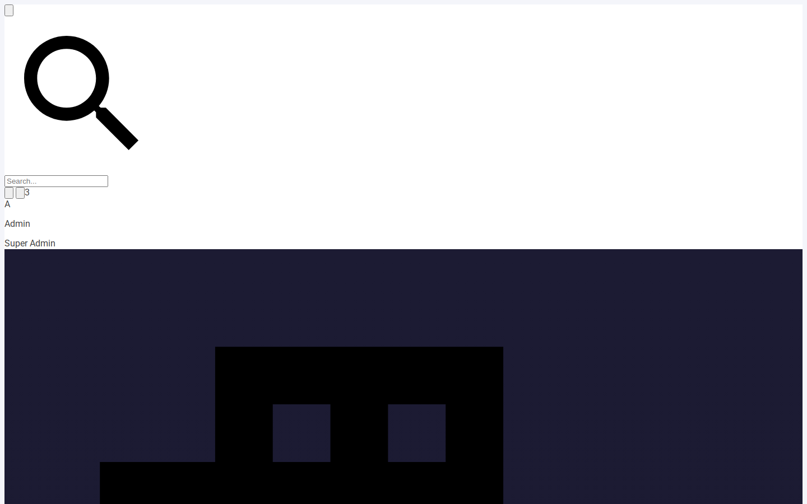
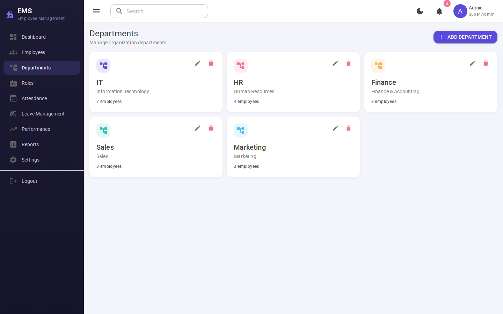

# Employee Management System (EMS)

[](https://github.com/yasirmalik36/employee-management-system/actions/workflows/ci.yml)

A modern, professional SaaS-style HRMS built with **.NET 8**, **Blazor Web App (Interactive Server)**, and **MudBlazor**. It covers employees, departments, roles, attendance, leave, performance reviews and reports, and runs out of the box on seeded demo data.

## 📸 Screenshots

Captured from the running app (in-memory sample data) by the [Refresh screenshots](.github/workflows/screenshots.yml) workflow.

| Dashboard | Employees |
|---|---|
|  |  |
| **Attendance** | **Leave management** |
|  |  |
| **Performance** | **Departments** |
|  |  |

## Tech Stack
- .NET 8 / Blazor Web App (Interactive Server render mode)
- MudBlazor (UI components, theming, charts)
- Entity Framework Core (SQL Server provider wired up; **InMemory provider used by default** so the app runs instantly with seeded fake data)
- AutoMapper
- FluentValidation

## Running locally
1. Install the [.NET 8 SDK](https://dotnet.microsoft.com/download/dotnet/8.0).
2. From the project folder:
   ```bash
   dotnet restore
   dotnet run
   ```
3. Open the URL shown in the console (e.g. `http://localhost:5180`).

No database setup is required — the app seeds realistic fake employees, departments, roles, attendance, leave requests, and performance reviews into an in-memory store (`Data/InMemoryDataStore.cs`) on startup.

### Switching to real SQL Server
1. Update the connection string in `appsettings.json`.
2. In `Program.cs`, change:
   ```csharp
   builder.Services.AddDbContext<AppDbContext>(options =>
       options.UseInMemoryDatabase("EmployeeManagementSystemDb"));
   ```
   to:
   ```csharp
   builder.Services.AddDbContext<AppDbContext>(options =>
       options.UseSqlServer(builder.Configuration.GetConnectionString("DefaultConnection")));
   ```
3. Add an EF Core migration (`dotnet ef migrations add InitialCreate`) and update the service implementations in `Services/` to query `AppDbContext` instead of `InMemoryDataStore` (the interfaces in `Interfaces/` stay the same — that's the point of the clean-architecture split).

## Project Structure
```
Components/
  Layout/      MainLayout, NavMenu (collapsible sidebar, top bar)
  Pages/       Dashboard, Employees, AddEmployee, EmployeeDetails,
               Departments, Roles, Attendance, LeaveManagement,
               Performance, Reports, Settings, Logout
  Shared/      KpiCard, StatusChip
Models/        Employee, Department, Role, Attendance, LeaveRequest, PerformanceReview, enums
DTOs/          EmployeeListDto, EmployeeDetailsDto, EmployeeCreateDto, Dashboard/Report DTOs
Interfaces/    IEmployeeService, IDepartmentService, IRoleService, IAttendanceService,
               ILeaveService, IPerformanceService, IDashboardService
Services/      In-memory implementations of every interface above
Validators/    FluentValidation validators (EmployeeCreateDto, Department, Role)
Data/          AppDbContext (EF Core, ready for SQL Server) + InMemoryDataStore (seeded fake data)
wwwroot/css/   app.css (SaaS theme: rounded cards, sidebar gradient, status chip colors)
```

## Features implemented
- Collapsible sidebar navigation + top bar (search, notifications, profile)
- Dashboard: KPI cards, employee trend line chart, department donut chart, recent hires, upcoming birthdays
- Employees: searchable/sortable/paginated table, filters (department/role/status), add/edit/view/delete
- Add/Edit Employee: MudForm + FluentValidation, file upload field, reporting manager dropdown
- Employee Details: profile card + tabs (Overview, Personal Info, Documents, Attendance, Leave, Performance), skills chips, leave balance cards
- Departments & Roles: card/table views with add/edit/delete dialogs
- Attendance: searchable/filterable table with check-in/out, hours, status chips
- Leave Management: approve/reject pending requests
- Performance: goals with progress bars, ratings
- Reports: summary KPIs, department bar chart, gender donut chart, tabs for attendance/leave/performance reports
- Settings: profile, theme, notifications, password tabs
- Light/Dark mode toggle (top bar icon)
- Fully async service methods, constructor-injected interfaces throughout (DI-friendly clean architecture)

## Notes
- All data is **seeded demo data held in memory**; see `Data/InMemoryDataStore.cs` to adjust the dataset.
- Avatars use `https://i.pravatar.cc` placeholder images — swap with real upload storage when wiring up a backend.
